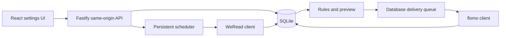

# Architecture and deployment

[English](architecture.md) · [简体中文](architecture.zh-CN.md)

## Technology and implementation scope

TypeScript, React/Vite, Node.js/Fastify (24 LTS recommended; minimum 22.18) and SQLite. M3 implements authentication, connections, background synchronization, browsing, rules and persistent scheduling/delivery. Dependencies and the lockfile are pinned. Docker packaging remains future work.

The runtime uses `better-sqlite3` with WAL, `busy_timeout`, foreign keys, transactional migrations and a separate SQLite exclusive-lock file. Candidate-schema tests use Node's built-in SQLite. Local verification covers Linux arm64; cross-platform images and an online backup API remain M4 work. Current backups require stopping the application.

## One service, separate modules

Code is organized into frontend, backend and shared contracts. Provider clients, normalization, persistence, rules, scheduling, delivery and authentication are regular modules in one process. There is no Redis, message broker or microservice layer.

The frontend calls only the local backend and never sends third-party credentials directly upstream. Network payloads require runtime validation; TypeScript types alone are insufficient. Unknown fields remain in raw JSON without inferred meaning.

React uses i18next/react-i18next with bundled JSON language resources. A stored browser choice overrides browser-language detection. Locale changes affect interface labels and date formatting, not stored notes or outgoing content. See [Localization](localization.md).

## Deployment

`npm ci`, `npm run build`, then `npm start`. One Node process serves static assets, the API, sync and delivery jobs. A system service manager such as systemd can keep it running. Closing the browser does not stop jobs.

Data, secrets and optional configuration default to the current account's external application-data directory; see [Operations](usage.md). Only one instance may use a data directory. An existing active instance causes startup to fail.

The default listener is loopback. Public access requires a deployer-managed HTTPS reverse proxy or tunnel and an exact `APP_ORIGIN`. Tunnels such as ngrok or Cloudflare are optional infrastructure; the repository includes no personal domain or token. Dockerfiles, Compose and multi-architecture images are not yet provided.

## Scheduling

The database holds enablement, next due times and results; in-memory timers only wake the scheduler. Restart recovery does not rely on `setInterval` state.

Source reads and delivery have separate state. A failed sync does not empty the queue. Same-kind jobs do not overlap, and manual triggers share locks. Missed schedules catch up once instead of producing a backlog of requests.

Automation is initially off. The default interval is 15 minutes, adjustable from 5 to 10,080 minutes, or a daily time. Light mode forces a full scan on the next scheduled run when the last successful full scan is at least 24 hours old. Each startup requires a successful full sync before delivery. Application scheduling limits do not imply upstream permission for that request rate.

Reads use timeouts, bounded retries, backoff and `Retry-After`. Expired credentials or `upgrade_info` pause work with a visible error. Ambiguous writes follow the delivery state machine and must not reuse read-retry semantics.

## Credentials and login

Initialization requires the locally held setup secret in the request body, never the URL. Setup closes after the administrator is created. Passwords use salted Node `crypto.scrypt`; server-side sessions expire and can be revoked.

Cookies use HttpOnly, SameSite and Secure when the configured origin is HTTPS. Mutations check Origin and CSRF. Login/setup are rate-limited. Configuration, notes and scheduler state require authentication. The server repeats all relevant validation.

Saved WeRead keys and flomo URLs are never returned. Connections reference encrypted secrets. AES-256-GCM uses a separate random nonce per secret and an independent master-key file. Existing databases require the matching key; missing/mismatched keys cause refusal rather than replacement. This does not protect against a compromised host or process.

Upstream destinations are restricted to validated official HTTPS origins and paths. Cross-origin redirects are disabled to prevent credential forwarding and SSRF. Tests inject fake clients; production has no arbitrary-domain switch.

Authorization, cookies, credential-bearing URLs and request bodies are redacted. Note text belongs in the database, not ordinary logs. There is no built-in telemetry.

## Health, backups and upgrades

`/api/health` reports application responsiveness without personal data. It does not probe providers or perform a database integrity check. Authenticated pages expose job status.

Stop the service and back up the complete data directory and independent key directory. Do not copy only the live main SQLite file and omit WAL. There is no online backup task, UI backup button or configurable retention policy. Restore with `npm run restore -- --from /absolute/path/backup/app.sqlite`; it validates the database/key and enables recovery protection until delivery history is reviewed.

Back up before upgrades. Migrations run in sequence; failures preserve data and prevent workers from starting. Older applications reject newer database versions. Recovery uses matching backups; automatic reversal of every migration is not promised.

References: [Node LTS](https://nodejs.org/en/about/previous-releases), [Fastify](https://fastify.dev/docs/latest/), [Vite](https://vite.dev/guide/), [Docker volumes](https://docs.docker.com/engine/storage/volumes/).
